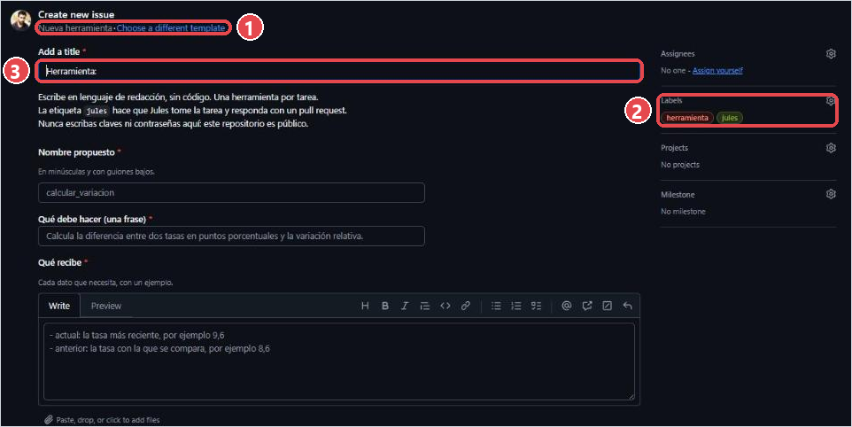

# Jules: el agente de programación del curso

Jules (de Google) es un agente que trabaja sobre tu fork: lee el código, propone un plan, hace los cambios en
una máquina virtual, comprueba que compilen y te entrega un pull request. Tú decides si se fusiona. El nivel
gratuito permite **15 tareas por día** (y 3 a la vez). Fuente: jules.google/docs, consultada el 22-10-2026.

## 1. Conectar Jules a tu fork (una vez)

1. Entra a **jules.google** con tu Gmail institucional y acepta el aviso de privacidad.
2. En la portada aparece **Import your repos · Connect to GitHub**: apriétalo → en GitHub, elige **Only select
   repositories** → tu `ia-toolkit` → autoriza. Solo tu fork: Jules no necesita ver nada más.
3. Punto de control: en jules.google, arriba, aparece `<tu-usuario> / ia-toolkit`.

> ⚠ Conecta Jules **antes** de crear el primer issue. Si creas el issue con la etiqueta `jules` y después
> conectas Jules, la tarea no se dispara: en el issue, quita la etiqueta `jules` y vuelve a ponerla (engranaje
> de **Labels**).
4. Si después quieres cambiar el acceso: GitHub → tu foto → **Settings** → **Applications** →
   **Google Labs Jules** → **Configure** → **Repository access**.
5. Opcional (la primera vez): en Jules, abre tu repositorio → **Configuration** → en *Initial Setup* escribe
   `cd backend && npm ci && cd ../frontend && npm ci` → **Run and Snapshot**. Así cada tarea parte con las
   dependencias instaladas. Jules también lee `AGENTS.md`, que le explica el proyecto.

## 2. Pedir una tarea

**Desde GitHub (recomendado):** en tu fork → **Issues** → **New issue** → elige la plantilla **Nueva
herramienta** o **Nueva regla del objetivo**.

La plantilla elegida aparece arriba ①, y ya trae las etiquetas **herramienta** y **jules** ②. Completa el
título ③ (después de "Herramienta:") y todos los campos, y aprieta **Create**. En el ensayo, a los 15 segundos
apareció en el issue el comentario de `google-labs-jules[bot]`: *"Jules is on it… When finished, you will see
another comment and be able to review a PR."* El enlace *on it* abre la tarea en jules.google, donde se ve qué
está haciendo y cuántas tareas te quedan en el día (*Daily session limit (1/15)*).

**Desde jules.google:** botón **+** → elige tu repositorio y la rama `main` → escribe la tarea → **Give me a
plan** → revisa el plan y apruébalo. Al terminar, Jules publica una rama; desde GitHub abres el pull request
(**Compare & pull request**).

Cómo escribir una buena tarea:

- Una cosa por tarea. "Agrega calcular_variacion" sí; "agrega tres herramientas y cambia los colores" no.
- Di qué debe hacer, qué recibe, qué devuelve, y cómo se comprueba en la traza (la plantilla lo pregunta).
- Ejemplo: *Agrega una herramienta `calcular_variacion` que reciba dos tasas (actual y anterior) y devuelva la
  diferencia en puntos porcentuales y la variación relativa. El agente debe usarla cuando compare con el año
  anterior. Se comprueba en la traza de `/correr?forzar=1`.*

## 3. Revisar el pull request

1. Abre el PR. Lee la descripción: qué cambió, cómo verificarlo, qué podría romperse.
2. Pestaña **Files changed**: en verde lo que se agrega, en rojo lo que se quita. Busca el archivo nuevo en
   `backend/src/herramientas/` y la línea nueva en `index.ts`.
3. Abajo, la marca de **Verificar**: verde = compila el backend y se construye el frontend. Roja = algo no
   compila: **Details** muestra el error. Pídele a Jules que lo arregle comentando en el PR o en la tarea.
4. Si todo está bien: **Merge pull request** → **Confirm merge**.

## 4. Ver el resultado en producción

1. Cloudflare despliega solo al fusionar (1–2 minutos). Lo ves en el Worker → **Deployments**.
2. Abre `https://ia-toolkit.<tu-subdominio>.workers.dev/` : la herramienta nueva aparece en `herramientas`.
3. Abre `/correr?forzar=1` y busca en la traza `El modelo pidió <nombre>(...)`. Si el modelo no la pidió, el
   problema suele ser la descripción de la herramienta (lo que lee el modelo para decidir), no el código.

## Qué pedirle y qué no

- Sí: herramientas nuevas, reglas nuevas, cambios de textos o estilos, explicar un archivo, arreglar un PR
  rojo.
- No: nunca le escribas claves, contraseñas ni el contenido de los secretos (este repositorio es público). No
  le pidas que despliegue: el despliegue ocurre solo al fusionar. No le pidas cambiar el nombre del Worker ni
  las `migrations` de `wrangler.jsonc`.
- Una tarea por vez: espera a fusionar (o cerrar) un PR antes de pedir el siguiente, para que no choquen.
